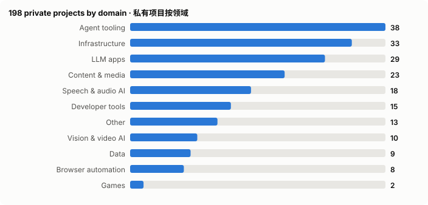

<picture>
  <source media="(prefers-color-scheme: dark)" srcset="assets/hero-dark.svg">
  
</picture>

<picture>
  <source media="(prefers-color-scheme: dark)" srcset="assets/neofetch-dark.svg">
  
</picture>

I package open-source AI models for speech, translation, OCR and talking-head video into all-in-one Docker images with a Web UI, REST API and MCP server, so they're easy to run locally. I also build agent tooling: MCP servers, AI agent skills and a Bash loop that drives a coding agent through PRD user stories. I've built ZK identity protocols on HashKey Chain and send fixes and security reports upstream.

> 我把语音合成、翻译、OCR、数字人视频等开源 AI 模型打包成集成 Web UI、REST API 和 MCP 服务的 Docker 镜像，方便本地部署。我也开发 AI 智能体工具、MCP 服务器，以及 HashKey Chain 上的零知识身份与合规协议。

---

## ✨ Highlights · 亮点

- 🛡️ Credited **Reporter** of security advisory [GHSA-f8v6-r4j4-f7r7](https://github.com/lexmount/moli/security/advisories/GHSA-f8v6-r4j4-f7r7) (high) in [lexmount/moli](https://github.com/lexmount/moli) — moli serve: web pages could take over the CDP endpoint (no Origin / Host validation) and read local files
- 🔧 4 merged pull requests to 2 other open-source projects:
  - [lexmount/moli#2293](https://github.com/lexmount/moli/pull/2293) fix(renderer): never reuse backendNodeIds across Documents
  - [lexmount/moli#2292](https://github.com/lexmount/moli/pull/2292) fix(serve): honor --document-start-script in protocol-server pages
  - [lexmount/moli#2295](https://github.com/lexmount/moli/pull/2295) fix(system-info): accept the frontend's browser session (SystemInfo always rejected over real connections)
  - [wiltodelta/remove-ai-watermarks#11](https://github.com/wiltodelta/remove-ai-watermarks/pull/11) fix(ctrlregen): correct module import paths

## 🚀 Start here · 从这里开始

**[cosyvoice-docker](https://github.com/neosun100/cosyvoice-docker)** — ★89 · Python · Speech & audio AI

All-in-one Docker image serving the Fun-CosyVoice3-0.5B TTS model with a Web UI, OpenAI-compatible REST API and voice cloning. 一体化Docker镜像，基于Fun-CosyVoice3-0.5B提供语音合成、Web界面、OpenAI兼容API与声音克隆。

  - OpenAI-compatible /v1/audio/speech endpoint with real PCM streaming at ~1.2s TTFB
  - Custom voice management with Fun-ASR-Nano auto-transcription; embedding cache 53% faster after first use
  - Supports Chinese, English, Japanese, Korean plus 18 dialects; deploy with one docker run command

  `Python` `Docker` `CosyVoice` `Fun-ASR-Nano` `NVIDIA Container Toolkit`

**[translategemma](https://github.com/neosun100/translategemma)** — ★40 · Python · LLM apps

A local AI translation service built on Google's TranslateGemma, offering a Web UI, REST API and MCP integration for 55 languages. 基于 Google TranslateGemma 的本地翻译服务，含 Web 界面、REST API 和 MCP，支持55种语言。

  - All-in-one 82GB Docker image with all 6 models (4B/12B/27B, Q4/Q8) embedded
  - Smart chunking for long text and streaming translation output via REST API
  - MCP integration that works with Claude Desktop and other AI assistants

  `Python` `TranslateGemma` `Docker` `CUDA` `GGUF` `MCP`

**[supertonic-tts-enhanced](https://github.com/neosun100/supertonic-tts-enhanced)** — ★23 · Python · Speech & audio AI

An enhanced packaging of the Supertonic on-device TTS system that bundles it in a Docker image with a FastAPI server and a Streamlit web UI. 基于 Supertonic 本地语音合成系统的增强版，用 Docker 打包，并提供 FastAPI 服务和 Streamlit 网页界面。

  - One-command all-in-one Docker image with GPU (CUDA 12.6.3) or CPU-only mode
  - FastAPI /synthesize endpoint on port 8088 with API docs and a health check
  - Streamlit UI on port 8501 with 4 voice styles, speed/quality settings, downloads and history

  `Python` `ONNX Runtime` `FastAPI` `Streamlit` `Docker` `CUDA`

**[kokoro-tts](https://github.com/neosun100/kokoro-tts)** — ★19 · Python · Speech & audio AI

All-in-one Docker image for Kokoro-82M text-to-speech with a web UI, REST API, WebSocket, streaming, batch and MCP. Kokoro-82M 文本转语音一体化 Docker 镜像，含 Web 界面、REST API、WebSocket、流式、批处理和 MCP。

  - Supports 8 languages and offers 54+ male and female voices
  - CUDA GPU acceleration with idle-timeout memory release, plus a CPU fallback
  - MCP server lets AI agents such as Claude use the TTS service

  `Python` `Docker` `CUDA` `Kokoro-82M` `WebSocket` `MCP`

**[MuMuAINovel](https://github.com/neosun100/MuMuAINovel)** — ★18 · Python · LLM apps

An AI-powered novel writing assistant that generates outlines, characters, worldbuilding and chapters using OpenAI, Gemini or Claude models. 基于 AI 的小说创作助手，可借助 OpenAI、Gemini 或 Claude 生成大纲、角色、世界观和章节。

  - Lets you switch between OpenAI, Gemini, Claude and custom API endpoints
  - Tracks foreshadowing, checks consistency, scores chapter quality (S/A/B/C/D) and detects duplicate content
  - Deploys with Docker Compose on PostgreSQL; README lists 200+ API endpoints

  `Python` `FastAPI` `React` `PostgreSQL` `Docker`

## 📊 By the numbers · 数据

<picture>
  <source media="(prefers-color-scheme: dark)" srcset="assets/categories-dark.svg">
  
</picture>
<picture>
  <source media="(prefers-color-scheme: dark)" srcset="assets/languages-dark.svg">
  
</picture>
<picture>
  <source media="(prefers-color-scheme: dark)" srcset="assets/stars-dark.svg">
  
</picture>
<picture>
  <source media="(prefers-color-scheme: dark)" srcset="assets/timeline-dark.svg">
  
</picture>

## 🔒 Beyond the public repos · 公开仓库之外

- **19,838 commits** authored in the past year, on **235 different days**, across **225 repositories** (merge commits excluded; counted from local git history).
- 近一年本人提交 **19,838** 个，分布在 **235** 天、**225** 个仓库（不含 merge 提交）。

<picture>
  <source media="(prefers-color-scheme: dark)" srcset="assets/skyline-dark.svg">
  
</picture>

Flat view · 平面日历

<picture>
  <source media="(prefers-color-scheme: dark)" srcset="assets/activity-dark.svg">
  
</picture>

- **198 private or unlisted projects** — 8 are introduced below, the rest stay unnamed. By domain: Agent tooling (38), Infrastructure (33), LLM apps (29), Content & media (23), Speech & audio AI (18). Languages: Python (90), TypeScript (22), Shell (21), JavaScript (18), HTML (17).
- 另有 **198** 个私有或未列出的项目（下面介绍其中 8 个，其余不列名字）。按领域：Agent 工具 38、基础设施 33、大模型应用 29、内容与媒体 23、语音与音频 AI 18。

<picture>
  <source media="(prefers-color-scheme: dark)" srcset="assets/private-dark.svg">
  
</picture>

### 🔒 Private spotlight · 私有项目精选

_Selected private projects — code not public, described here with the owner's permission. 部分私有项目：代码不公开，经本人同意在此介绍。_

<table>
<tr>
<td width="50%" valign="top"><b>🔒 llm-odyssey</b> Content & media A Chinese LLM explainer video series whose code is written by Claude and rendered frame by frame by a custom engine, with frame = f(t). 由 Claude 写代码、自研引擎逐帧渲染的中文 LLM 科普短视频系列，每一帧都是时间的纯函数。<ul><li>Custom engine (Bun + three.js + Canvas2D, WebCodecs H.264) renders the same frame bit-identically</li><li>On-screen numbers come from per-episode data scripts that can be recomputed with --check</li><li>Pure policy.decide() caps revisions at 3 rounds; LLM steps are one-shot Agent SDK query() calls</li></ul><code>TypeScript</code> <code>Bun</code> <code>three.js</code> <code>Canvas2D</code> <code>WebCodecs</code> <code>Python</code></td>
<td width="50%" valign="top"><b>🔒 mc-agent</b> Agent tooling An AI society experiment where autonomous LLM residents live in a Minecraft Forge world, building, farming and talking without commands. AI 社会实验：自主 LLM 居民生活在 Minecraft Forge 世界里，无需指令也会盖楼、种地、交流。<ul><li>77 hand-written character cards, 36 residents online across 9 shard processes on a 75-mod Forge server</li><li>Tiered ReflexRouter: L0 emergency reflexes run in under 50ms with no LLM calls</li><li>959 passing tests; safety whitelist stops residents from attacking real players</li></ul><code>JavaScript</code> <code>Node.js</code> <code>mineflayer</code> <code>Python</code> <code>Minecraft Forge</code> <code>uv</code></td>
</tr>
<tr>
<td width="50%" valign="top"><b>🔒 mac-h3c</b> Vision & video AI A C/Metal port of MiniMax-H3 for Apple Silicon that makes video and audio from prompts, with frame and reference conditioning. 面向 Apple Silicon 的 MiniMax-H3 原生 C/Metal 推理，可由提示词生成音视频，支持首尾帧与参考素材条件。<ul><li>Prompt-to-video/audio, first/last-frame and ordered Ref2VA image/video/audio references work end to end</li><li>Interactive session keeps prompt conditioning, DiT and decoder in memory to rerun with new seeds</li><li>Speed options: --reuse extrapolates skipped denoising steps, --layers runs fewer transformer blocks</li></ul><code>C</code> <code>Metal</code> <code>FFmpeg</code> <code>Hugging Face</code></td>
<td width="50%" valign="top"><b>🔒 TermHub</b> Agent tooling TermHub is an agent-mode terminal hub where Codex watches Claude Code sessions in the terminal and keeps pushing them toward a goal you set. TermHub 是 Agent 模式的终端中枢，由 codex 监看并托管 Claude Code 会话，一轮轮推进直到目标达成。<ul><li>Codex reads each terminal screen and decides whether to nudge the session, answer for you, or call for a human</li><li>Runs as a macOS Electron desktop app or a pure-Node web server, both on one shared core</li><li>Responsive web UI with touch shortcut keys for answering Claude Code prompts on a phone</li></ul><code>TypeScript</code> <code>Electron</code> <code>Node.js</code> <code>tmux</code> <code>WebSocket</code> <code>pnpm</code></td>
</tr>
<tr>
<td width="50%" valign="top"><b>🔒 touchstone</b> Agent tooling A Claude Code skill set that teaches how to verify code, not write it, routing to existing skills and filling gaps like mutation checks. Claude Code 开发总纲 skill：不教写代码而教怎么验，路由现有 skill 并补上变异验证等空白。<ul><li>README badges list 432 tests, 319 registered mutations and 54 verified routes</li><li>Survey of 243 installed skills found 4 that do contract work, and none of the 4 has a forcing function</li><li>Scope was set by a falsification study in which 4 agents read the body text of 32 skills</li></ul><code>Python</code> <code>Claude Code</code></td>
<td width="50%" valign="top"><b>🔒 gba-metro-map</b> Data A code-drawn Greater Bay Area rail map joining MTR, nine-city metros, intercity, HSR and border crossings for route planning. 代码绘制的粤港澳大湾区轨道地图，港铁、九城地铁、城际、高铁与口岸连成一张图，可规划跨城跨境路线。<ul><li>450 HK–Shenzhen stations placed per official maps; zero stations at sea in both map versions</li><li>Cross-border route planning with transfers, crossings and time estimates, plus reachability areas</li><li>Deterministic, rerunnable pipeline from OSM and Natural Earth; no map tiles</li></ul><code>Python</code> <code>uv</code> <code>OpenStreetMap</code> <code>SVG</code> <code>Vitest</code> <code>Capacitor</code></td>
</tr>
<tr>
<td width="50%" valign="top"><b>🔒 moli-control</b> Browser automation A browser CLI for AI agents that drives Moli headless and managed Chrome with one command set, verifying every action. 面向 AI agent 的浏览器控制 CLI，用一套命令驱动 Moli 轻内核与受管真 Chrome 两个后端，每个动作都回读核实。<ul><li>Each command prints one line of JSON, and errors include a machine-readable code and an actionable hint</li><li>Reports unsupported actions explicitly instead of faking success; 304 tests and 202 mutations gate each release</li><li>Has equivalents for 51 of 52 chrome-control subcommands and guards against a webpage taking over the Moli instance</li></ul><code>Python</code> <code>Rust</code> <code>CDP</code> <code>Chrome</code> <code>Moli</code></td>
<td width="50%" valign="top"><b>🔒 chrome-control</b> Browser automation A Python CLI that controls Chrome directly via CDP, including extensions, settings, bookmarks and incognito windows. 直接用 CDP 控制 Chrome 的 Python 命令行工具，可操作扩展、设置、书签、无痕窗口等。<ul><li>Claims all 669 CDP commands are reachable; README cites 1867 tests</li><li>Uses chrome:// pages via Runtime.evaluate to list extensions and edit 191 settings</li><li>Only one dependency (websocket-client); targets Chrome 151+</li></ul><code>Python</code> <code>Chrome DevTools Protocol</code> <code>JSON-RPC</code> <code>websocket-client</code></td>
</tr>
</table>

## 🧰 Stack · 技术栈

<picture>
  <source media="(prefers-color-scheme: dark)" srcset="assets/orbit-dark.svg">
  
</picture>

Full list · 完整列表

`Python` `Docker` `CUDA` `FastAPI` `MCP` `PyTorch` `Gradio` `WebSocket` `TypeScript` `Solidity` `JavaScript` `HashKey Chain` `vLLM` `Swagger` `Flask` `NVIDIA Container Toolkit` `ONNX Runtime` `Docker Compose` `Node.js` `Whisper` `Transformers` `Hardhat` `GGUF` `React` `HuggingFace` `Nginx` `ffmpeg` `HTML`

## 📦 All public projects · 全部公开项目（97）

_Every public project below, with an English and a Chinese one-liner. 下面是全部公开项目，每条附中英一句话。_

### Agent tooling · Agent 工具（9）

- [**expert-knowledge-extraction**](https://github.com/neosun100/expert-knowledge-extraction) `★4` An AI agent skill that researches a new domain, designs strategic expert interview questions, and turns expert knowledge into method docs. 一套 AI Agent 技能指令，帮助深度研究陌生领域、设计战略性访谈问题，并将专家隐性知识萃取为可复用的方法论文档。
- [**kirby**](https://github.com/neosun100/kirby) `★3` · Shell Kirby is a Bash loop that runs an AI coding agent on PRD user stories, using a fresh AI instance each iteration until every story is done. Kirby 是一个 Bash 循环脚本，每轮启动一个新的 AI 实例逐个实现 PRD 用户故事，直到全部完成。
- [**open-vibe-island**](https://github.com/neosun100/open-vibe-island) `★1` · Swift Fork of Open Island, a native macOS notch app showing AI coding agent sessions, permission approvals and terminal jump-back. Open Island 的分支：开源原生 macOS 刘海栏应用，为 AI 编程代理提供会话状态、权限审批和终端跳转。
- [**zfile-mcp-server**](https://github.com/neosun100/zfile-mcp-server) `★1` · Python An MCP server for ZFile that lets AI assistants list files, upload files, and generate shareable direct or short download links. 面向 ZFile 的 MCP 服务器，让 AI 助手能够浏览目录、上传文件，并生成可分享的直链或短链。

5 more · 展开其余 5 个

- [**deep-research-ppt-skill**](https://github.com/neosun100/deep-research-ppt-skill) `★1` An AI assistant skill that researches any topic and outputs structured Markdown reports plus a PPT with detailed speaker notes. 一个AI助手技能，可对任意课题做深度研究，输出结构化Markdown报告和带详细演讲备注的PPT。
- [**hk-horizon-2026-ai-Sentinel-Treasury**](https://github.com/neosun100/hk-horizon-2026-ai-Sentinel-Treasury) · TypeScript AI treasury copilot for HashKey Chain that recommends liquidity, yield and payout splits and executes them on-chain after approval. 面向 HashKey Chain 的黑客松阶段 AI 金库助手，建议如何在流动性、收益和支付储备之间分配资金，并通过策略管控执行链上操作。
- [**hk-horizon-2026-defi-Eternal-Life**](https://github.com/neosun100/hk-horizon-2026-defi-Eternal-Life) · Solidity K-Life is AI agent life insurance on HashKey Chain that watches heartbeats, backs up memory to IPFS and resurrects agents that die. K-Life 是 HashKey Chain 上的 AI 智能体人寿保险协议，通过心跳监测和 IPFS 记忆备份，在智能体宕机后自动复活。
- [**hk-horizon-2026-ai-OmniAgent**](https://github.com/neosun100/hk-horizon-2026-ai-OmniAgent) · TypeScript Non-custodial yield router where an AI allocator runs sub-agents that pay each other via X402 and verify risk with ZK proofs. 非托管收益路由系统：AI 分配器管理子代理，代理间用 X402 微支付协作，并以零知识证明验证风险。
- [**hk-horizon-2026-ai-Pacifica-Pilot**](https://github.com/neosun100/hk-horizon-2026-ai-Pacifica-Pilot) · JavaScript An AI agent that trades Pacifica perpetuals using Gemini and Elfa sentiment, logging each decision on HashKey Chain. 基于 Gemini 与 Elfa 情绪交易 Pacifica 永续合约的 AI 代理，决策记录于 HashKey 链上。

### LLM apps · 大模型应用（8）

- [**translategemma**](https://github.com/neosun100/translategemma) `★40` · Python A local AI translation service built on Google's TranslateGemma, offering a Web UI, REST API and MCP integration for 55 languages. 基于 Google TranslateGemma 的本地翻译服务，含 Web 界面、REST API 和 MCP，支持55种语言。
- [**MuMuAINovel**](https://github.com/neosun100/MuMuAINovel) `★18` · Python An AI-powered novel writing assistant that generates outlines, characters, worldbuilding and chapters using OpenAI, Gemini or Claude models. 基于 AI 的小说创作助手，可借助 OpenAI、Gemini 或 Claude 生成大纲、角色、世界观和章节。
- [**langextract-web**](https://github.com/neosun100/langextract-web) `★9` · Python A web UI, REST API and MCP server wrapper for Google's LangExtract that uses LLMs to pull structured information out of text. 为 Google LangExtract 提供 Web 界面、REST API 和 MCP 封装，借助大模型从文本中提取结构化信息。
- [**hy-mt**](https://github.com/neosun100/hy-mt) `★5` · Python All-in-one Docker deployment of Tencent HunyuanMT 1.5 with a Web UI, REST API and MCP server for translation in 38 languages. 腾讯混元翻译模型 1.5 的一体化 Docker 部署，含 Web 界面、REST API 和 MCP 服务器，支持 38 种语言。

4 more · 展开其余 4 个

- [**translategemma-cli**](https://github.com/neosun100/translategemma-cli) `★3` · Python A local translation service on Google's TranslateGemma, usable via Web UI, REST API or MCP, covering 55 languages. 基于 Google TranslateGemma 的本地翻译服务，提供 Web 界面、REST API 和 MCP，支持 55 种语言。
- [**fabric-docker**](https://github.com/neosun100/fabric-docker) `★2` · Go An all-in-one Docker deployment of the Fabric AI augmentation framework that runs a Web UI, a REST API, and an MCP server in one container. Fabric AI 增强框架的一体化 Docker 部署方案，单个容器内运行 Web UI、REST API 和 MCP 服务器。
- [**PaperRadar**](https://github.com/neosun100/PaperRadar) `★1` · Python A self-hosted AI research platform that finds new arXiv papers, then translates, analyzes and links them and sends alerts. 自托管的AI科研平台，自动从arXiv等来源发现论文，并进行翻译、分析、关联和消息推送。
- [**EasyPaper**](https://github.com/neosun100/EasyPaper) `★1` · Python Self-hosted web app that translates or simplifies English academic PDFs, highlights key sentences, and builds a knowledge base. 自托管 Web 应用，可翻译或简化英文学术论文 PDF 并保留排版，AI 高亮关键句，还能构建可导出的知识库。

### Speech & audio AI · 语音与音频 AI（32）

- [**cosyvoice-docker**](https://github.com/neosun100/cosyvoice-docker) `★89` · Python All-in-one Docker image serving the Fun-CosyVoice3-0.5B TTS model with a Web UI, OpenAI-compatible REST API and voice cloning. 一体化Docker镜像，基于Fun-CosyVoice3-0.5B提供语音合成、Web界面、OpenAI兼容API与声音克隆。
- [**supertonic-tts-enhanced**](https://github.com/neosun100/supertonic-tts-enhanced) `★23` · Python An enhanced packaging of the Supertonic on-device TTS system that bundles it in a Docker image with a FastAPI server and a Streamlit web UI. 基于 Supertonic 本地语音合成系统的增强版，用 Docker 打包，并提供 FastAPI 服务和 Streamlit 网页界面。
- [**kokoro-tts**](https://github.com/neosun100/kokoro-tts) `★19` · Python All-in-one Docker image for Kokoro-82M text-to-speech with a web UI, REST API, WebSocket, streaming, batch and MCP. Kokoro-82M 文本转语音一体化 Docker 镜像，含 Web 界面、REST API、WebSocket、流式、批处理和 MCP。
- [**soulx-podcast-docker**](https://github.com/neosun100/soulx-podcast-docker) `★18` · Python Docker deployment of SoulX-Podcast-1.7B for multi-speaker podcast speech, served via web UI, REST API and MCP server. SoulX-Podcast-1.7B 的 Docker 部署，生成多说话人播客语音，提供 Web UI、REST API 和 MCP 服务。

28 more · 展开其余 28 个

- [**indextts2-docker**](https://github.com/neosun100/indextts2-docker) `★17` · Python Docker images for IndexTTS2 that run zero-shot text-to-speech with emotion control, available through a REST API and a Gradio WebUI. IndexTTS2 的 Docker 镜像，提供带情感控制的零样本语音合成，可通过 REST API 和 Gradio WebUI 使用。
- [**qwen3-tts**](https://github.com/neosun100/qwen3-tts) `★16` · Python All-in-one Docker deployment of Qwen3-TTS with a Web UI and REST API for custom-voice, voice-design and voice-clone speech. Qwen3-TTS 一体化 Docker 部署，内置模型，提供 Web 界面和 REST API，支持自定义音色、音色设计和声音克隆。
- [**Qwen3-ASR**](https://github.com/neosun100/Qwen3-ASR) `★11` · Python All-in-one Docker deployment of Qwen3-ASR for 52-language speech recognition with a web UI, REST API and MCP server. Qwen3-ASR 一体化 Docker 部署，支持 52 种语言识别，含 Web 界面、REST API 和 MCP。
- [**personaplex**](https://github.com/neosun100/personaplex) `★11` · Python All-in-one Docker setup for PersonaPlex, a speech-to-speech model for real-time full-duplex voice chat with role and voice control. PersonaPlex 语音对话模型的一体化 Docker 部署，支持实时全双工语音对话，可用文本提示设定角色并选择音色。
- [**soniox-asr-web**](https://github.com/neosun100/soniox-asr-web) `★7` · JavaScript A Soniox API web app that transcribes audio/video files and does real-time speech recognition and translation over WebSocket. 基于 Soniox API 的语音识别 Web 应用，可转写音视频文件、通过 WebSocket 实时识别并翻译语音。
- [**glm-asr**](https://github.com/neosun100/glm-asr) `★7` · Python A speech recognition service built on GLM-ASR-Nano, offering a Web UI, a REST API with SSE streaming, and segmentation for long audio. 基于 GLM-ASR-Nano 的一体化语音识别服务，提供 Web 界面、REST API 和 SSE 流式输出，并支持长音频。
- [**fun-asr-docker**](https://github.com/neosun100/fun-asr-docker) `★7` · Python An all-in-one Docker image that serves Alibaba's Fun-ASR-Nano-2512 speech recognition model through a Web UI, a REST API, and WebSocket. 基于 Fun-ASR-Nano-2512 的一体化 Docker 语音识别服务，含 Web 界面、REST API 和 WebSocket。
- [**faster-whisper-web**](https://github.com/neosun100/faster-whisper-web) `★6` · Python A GPU-accelerated speech transcription service built on faster-whisper, with a web UI, streaming output and an OpenAI-compatible API. 基于 faster-whisper 的 GPU 加速语音转写服务，提供 Web 界面、流式输出和兼容 OpenAI 的 API。
- [**mlx-audio**](https://github.com/neosun100/mlx-audio) `★5` · Python A text-to-speech and speech-to-text library and web service built on Apple's MLX framework that streams generated audio on Apple Silicon. 基于 Apple MLX 框架的语音合成与语音识别库及 Web 服务，可在 Apple Silicon 上流式输出生成的音频。
- [**Step-Audio-R1.1**](https://github.com/neosun100/Step-Audio-R1.1) `★4` · Python All-in-one Docker deployment of the Step-Audio-R1.1 audio language model with vLLM, a Web UI and an OpenAI-compatible API. Step-Audio-R1.1 音频语言模型的一体化 Docker 部署，含 vLLM、Web 界面和 OpenAI 兼容 API。
- [**Fun-Audio-Chat**](https://github.com/neosun100/Fun-Audio-Chat) `★4` · Python All-in-one Docker image for the Fun-Audio-Chat audio language model, with a bilingual web UI, REST API and MCP support. Fun-Audio-Chat 音频语言模型的一体化 Docker 镜像，含双语 Web 界面、REST API 与 MCP 支持。
- [**remove-noise-service**](https://github.com/neosun100/remove-noise-service) `★4` · Python A Dockerized, GPU-accelerated service that removes noise from audio files using the DeepFilterNet model, with a Swagger-documented HTTP API. 基于 DeepFilterNet 的 GPU 加速音频降噪服务，Docker 打包并提供 Swagger API 文档。
- [**whisperlivekit-enhanced**](https://github.com/neosun100/whisperlivekit-enhanced) `★4` · Python Enhanced WhisperLiveKit: a self-hosted, low-latency speech-to-text server with lazy model loading and automatic GPU memory release. WhisperLiveKit 增强版，一个自托管的低延迟语音转文字服务，支持模型懒加载和 GPU 显存自动释放。
- [**higgs-audio-web**](https://github.com/neosun100/higgs-audio-web) `★3` · Python An all-in-one Docker deployment for Higgs Audio v2 that provides a Web UI, REST API and MCP server for expressive TTS and voice cloning. Higgs Audio v2 一体化 Docker 部署，提供 Web 界面、REST API 和 MCP，支持语音合成与声音克隆。
- [**chatterbox-tts-docker**](https://github.com/neosun100/chatterbox-tts-docker) `★3` · Python All-in-one Docker image for Resemble AI's Chatterbox TTS with a Web UI, REST API, WebSocket and GPU memory management. Chatterbox TTS 一体化 Docker 镜像，含 Web 界面、REST API、WebSocket 与 GPU 显存管理。
- [**kyutai-tts-docker**](https://github.com/neosun100/kyutai-tts-docker) `★3` · Python A Docker deployment of Kyutai TTS that serves text-to-speech through a web UI, a REST API and MCP tools, and manages the GPU for you. Kyutai TTS 的 Docker 部署方案，通过 Web 界面、REST API 和 MCP 工具提供语音合成，并自动管理 GPU。
- [**kyutai-tts-gpu-resident**](https://github.com/neosun100/kyutai-tts-gpu-resident) `★2` · Python A Dockerized Kyutai TTS service that keeps the model in GPU memory, with 584 voices, voice cloning and streaming via web UI and REST API. Docker 化的 Kyutai 语音合成服务，模型常驻显存，提供 584 种音色、声音克隆和流式输出，含 Web 界面与 API。
- [**VibeVoice**](https://github.com/neosun100/VibeVoice) `★2` · Python Packaging of Microsoft's VibeVoice that serves real-time streaming text-to-speech over WebSocket from a Docker image. 微软 VibeVoice 的打包版本，通过 Docker 镜像和 WebSocket 提供实时流式文本转语音。
- [**ringtone-forge**](https://github.com/neosun100/ringtone-forge) `★1` · Python A Python CLI and agent skill that turns a song into a 30-second ringtone by finding its chorus and applying a genre-adaptive envelope. 一个 Python 命令行工具及智能体技能，可自动识别副歌并套用按曲风调整的音量包络，把歌曲制成 30 秒铃声。
- [**edgetts-ws**](https://github.com/neosun100/edgetts-ws) `★1` · Python A lightweight aiohttp HTTP API that wraps Microsoft Edge TTS and returns MP3 audio plus per-word timestamps for word-by-word highlighting. 基于 aiohttp 的轻量 HTTP API，封装微软 Edge TTS，返回 MP3 音频和逐词时间戳，可用于逐词高亮。
- [**fish-speech**](https://github.com/neosun100/fish-speech) `★1` · Python A multilingual text-to-speech system with reusable speaker voice profiles, auto-transcription and emotion control via REST API and WebUI. 多语言文本转语音系统，可保存并复用说话人声音档案、自动转写参考音频、控制情感，并提供 REST API 和 WebUI。
- [**IMS-Toucan**](https://github.com/neosun100/IMS-Toucan) `★1` · Python A Docker-packaged build of IMS-Toucan, the University of Stuttgart's multilingual text-to-speech system, with a Web UI and REST API. 将斯图加特大学的 IMS-Toucan 多语言文本转语音系统打包为 Docker 部署版本，提供 Web 界面和 REST API。
- [**orpheus-tts-docker**](https://github.com/neosun100/orpheus-tts-docker) `★1` · Python Docker deployment for Orpheus TTS that serves text-to-speech through a Web UI, a REST API and MCP, and manages GPU loading for you. Orpheus TTS 的 Docker 部署方案，提供 Web UI、REST API 和 MCP 语音合成服务并自动管理 GPU。
- [**Step-Audio2**](https://github.com/neosun100/Step-Audio2) `★1` · Python Docker-ready deployment of the Step-Audio 2 multimodal LLM for audio understanding and speech chat, with smart GPU memory management. Step-Audio 2 多模态音频大模型的 Docker 部署方案，支持音频理解与语音对话，并能智能管理 GPU 显存。
- [**llasa-tts-8b-webui**](https://github.com/neosun100/llasa-tts-8b-webui) `★1` · Python A text-to-speech system built on Llasa-8B that supports voice cloning and is served through a Gradio web UI, a Flask REST API and MCP. 基于 Llasa-8B 的文本转语音系统，支持声音克隆，提供 Gradio 网页界面、Flask REST API 和 MCP 访问。
- [**pyvideotrans**](https://github.com/neosun100/pyvideotrans) `★1` An AI-powered tool that translates and dubs videos. 一款基于AI的视频翻译与配音工具。
- [**Step-Audio-EditX-GPU-Managed**](https://github.com/neosun100/Step-Audio-EditX-GPU-Managed) `★1` · Python Step-Audio-EditX audio editing model with added GPU memory management that loads models on demand and offloads them when idle. 为 Step-Audio-EditX 3B 音频编辑模型加入 GPU 显存管理的版本，按需加载模型，空闲时自动卸载。
- [**Step-Audio-EditX-Optimized**](https://github.com/neosun100/Step-Audio-EditX-Optimized) · Python Optimized deployment of Step-Audio-EditX, a 3B LLM audio editing and zero-shot TTS model, with UI and API sharing one model instance. Step-Audio-EditX 优化部署版，UI 与 API 共享同一模型实例，支持音频编辑与零样本语音合成。

### Vision & video AI · 视觉与视频 AI（14）

- [**PersonaLive**](https://github.com/neosun100/PersonaLive) `★12` · Python A live-streaming portrait animation tool that animates a reference portrait from a webcam in real time or from a driving video offline. 面向直播的人像动画工具，可用摄像头实时驱动参考人像，也可离线根据参考图和驱动视频生成动画视频。
- [**sharp**](https://github.com/neosun100/sharp) `★8` · Python All-in-one Docker for Apple's SHARP model that turns one photo into a 3D Gaussian Splat scene, via Web UI, REST API or MCP. 苹果 SHARP 模型的一体化 Docker，将单张照片转为 3D 高斯泼溅场景，提供 Web 界面、REST API 和 MCP。
- [**infinitetalk-deployment**](https://github.com/neosun100/infinitetalk-deployment) `★8` · Python Docker and Gradio deployment for MeiGen-AI's InfiniteTalk and MultiTalk audio-driven video models, with auto model download. InfiniteTalk/MultiTalk 音频驱动视频模型的 Docker 与 Gradio 部署方案，支持模型自动下载。
- [**StableAvatar**](https://github.com/neosun100/StableAvatar) `★5` · Python Docker deployment of StableAvatar that turns one image plus audio into a talking-head video of any length. StableAvatar 的 Docker 部署版，用单张图片和音频生成任意时长的说话头像视频。

10 more · 展开其余 10 个

- [**HunyuanOCR-WebUI**](https://github.com/neosun100/HunyuanOCR-WebUI) `★4` · Python A Gradio web UI for Tencent's 1B-parameter HunyuanOCR model for text spotting, document parsing, info extraction and image translation. 基于腾讯混元OCR（1B参数）的Gradio网页界面，支持文字检测、文档解析、信息抽取、字幕提取和图片翻译。
- [**monkeyocr-multimodel**](https://github.com/neosun100/monkeyocr-multimodel) `★3` · Python A MonkeyOCR fork that adds Qwen2.5-VL-3B and Qwen3-VL-8B support to document parsing for handwritten ancient Chinese recognition. MonkeyOCR 的分支版本，在文档解析中加入 Qwen2.5-VL-3B 和 Qwen3-VL-8B 模型支持，用于手写古汉字识别。
- [**seedvr2-docker-allinone**](https://github.com/neosun100/seedvr2-docker-allinone) `★3` · HTML A Docker all-in-one build of ByteDance SeedVR2 that upscales videos and images through a bilingual web UI with a task queue. 基于字节跳动 SeedVR2 的 Docker 一体化视频/图像超分工具，提供中英双语 Web 界面和任务队列。
- [**depth-pro-docker**](https://github.com/neosun100/depth-pro-docker) `★2` · Python Docker deployment of Apple's Depth Pro for single-image metric depth estimation, with a Web UI, REST API and MCP server. Apple Depth Pro 的 Docker 部署，用单张图像估计度量深度，带 Web 界面、REST API 和 MCP 服务器。
- [**ditto-talkinghead**](https://github.com/neosun100/ditto-talkinghead) `★2` · Python A motion-space diffusion system that turns a single portrait image and an audio clip into a realistic, controllable talking head video. 基于运动空间扩散的系统，可由单张人像照片和音频生成逼真、可控的说话人头像视频。
- [**Z-Image-Studio**](https://github.com/neosun100/Z-Image-Studio) `★1` · Python An all-in-one Z-Image-Turbo toolkit for model downloads, multi-LoRA inference, LoRA training, and web UI management. Z-Image-Turbo 一体化工具包，支持模型下载、多 LoRA 推理、LoRA 训练及 Web 界面管理。
- [**Step1X-Edit-Docker**](https://github.com/neosun100/Step1X-Edit-Docker) `★1` · Python A Docker deployment of the Step1X-Edit image-editing model that offers a UI, an API and an MCP server, and manages GPU memory automatically. Step1X-Edit 图像编辑模型的 Docker 部署方案，提供 UI、API 和 MCP 服务，并自动管理 GPU 显存。
- [**ovis-image-docker**](https://github.com/neosun100/ovis-image-docker) `★1` · Python Docker deployment for the Ovis-Image 7B text-to-image model that serves a Web UI, REST API and MCP server from one container. Ovis-Image 7B 文生图模型的 Docker 部署方案，一个容器同时提供 Web 界面、REST API 和 MCP 服务。
- [**yolo11x-stream-detection**](https://github.com/neosun100/yolo11x-stream-detection) `★1` · Python A Dockerized system that runs Ultralytics YOLO11x detection on live RTMP video streams and serves annotated output over HLS. 基于 YOLO11x 的实时视频流检测系统，接收 RTMP 推流并以 HLS 输出检测结果。
- [**dots-ocr**](https://github.com/neosun100/dots-ocr) `★1` · Python A ~1.7B-parameter multilingual vision-language model that parses document layouts and recognizes their content. 约1.7B参数的多语种视觉语言模型，统一完成文档版面解析与内容识别，提供CLI、Gradio与vLLM使用方式。

### Developer tools · 开发者工具（2）

- [**electrify-web**](https://github.com/neosun100/electrify-web) `★3` · TypeScript A CLI tool that turns any website into a desktop app with one command, built as a modern revival of the abandoned Nativefier project. 一个命令行工具，一条命令即可把任意网站打包成桌面应用，是已停止维护的 Nativefier 项目的现代复兴版。
- [**cursor-session-manager**](https://github.com/neosun100/cursor-session-manager) `★1` · HTML A Cursor AI IDE tool that saves, restores, searches and auto-saves Cursor Agent conversation history via a web UI or CLI. Cursor AI IDE 会话管理工具，可通过网页界面或命令行保存、恢复、搜索和自动保存 Cursor Agent 对话历史。

### Infrastructure · 基础设施（7）

- [**lean-allinone**](https://github.com/neosun100/lean-allinone) `★6` · Python All-in-one Docker image for the QuantConnect Lean trading engine with GPU support, a Web UI, a REST API and an MCP server. QuantConnect Lean 交易引擎一体化 Docker 镜像，含 GPU 支持、Web 界面、REST API 与 MCP。
- [**kimi-linear-vllm-docker-serve**](https://github.com/neosun100/kimi-linear-vllm-docker-serve) `★2` · Python Docker image that serves Kimi-Linear-48B-A3B (AWQ-4bit) via vLLM with an OpenAI-compatible API and 128K–1M context. 用 vLLM 部署 Kimi-Linear-48B-A3B 的 Docker 镜像，兼容 OpenAI API，支持最长 1M 上下文。
- [**f-stack**](https://github.com/neosun100/f-stack) `★1` · C A copy of Tencent Cloud's F-Stack, a DPDK framework running the FreeBSD 13.0 network stack in user space, with added reports and docs. 腾讯云 F-Stack 的副本，基于 DPDK 将 FreeBSD 13.0 网络协议栈移植到用户态，并补充了研究报告和多语言文档。
- [**gpu-container-monitor**](https://github.com/neosun100/gpu-container-monitor) `★1` · HTML A real-time web dashboard for monitoring NVIDIA GPUs and managing GPU-enabled Docker containers. 一个实时 Web 仪表盘，用于监控 NVIDIA GPU 并管理启用 GPU 的 Docker 容器。

3 more · 展开其余 3 个

- [**hk-horizon-2026-zkid-Veritier**](https://github.com/neosun100/hk-horizon-2026-zkid-Veritier) · TypeScript A privacy-preserving tiered identity and access protocol for humans and AI agents on HashKey Chain, using Groth16 ZK proofs. HashKey Chain 上面向人类与 AI 代理的隐私保护分级身份与访问协议，基于 Groth16 零知识证明。
- [**hk-horizon-2026-zkid-Aria-Protocol**](https://github.com/neosun100/hk-horizon-2026-zkid-Aria-Protocol) · JavaScript Compliance middleware on HashKey Chain combining ZK-KYC, AI risk scoring, ERC-4626 vaults and HSP settlement for institutional DeFi. HashKey Chain 上的机构 DeFi 合规中间件，集成零知识 KYC、AI 风控、收益金库与 HSP 结算。
- [**quickwit-benchmark**](https://github.com/neosun100/quickwit-benchmark) · Python A Locust-based load testing project that measures query performance of the Quickwit logging system under concurrent users. 基于 Locust 的压测项目，用于测试 Quickwit 日志系统在高并发下的查询性能。

### Data · 数据（3）

- [**deepwiki-scraper**](https://github.com/neosun100/deepwiki-scraper) `★4` · JavaScript A tool that scrapes DeepWiki project documentation and merges it into a single Markdown file, via a command line or a web interface. 一个抓取 DeepWiki 项目文档并合并为单个 Markdown 文件的工具，支持命令行和 Web 界面。
- [**tradingview-api-python**](https://github.com/neosun100/tradingview-api-python) `★1` · JavaScript A Python FastAPI service serving TradingView real-time market data, technical analysis and indicators via REST. 基于 FastAPI 的 TradingView 行情服务，提供实时K线、技术分析和指标 REST 接口。
- [**hk-horizon-2026-defi-Critmin-Oracle**](https://github.com/neosun100/hk-horizon-2026-defi-Critmin-Oracle) · Python An on-chain oracle on HashKey Chain Testnet that publishes AI-computed risk scores for lithium, nickel and cobalt for DeFi use. 部署在 HashKey Chain 测试网上的链上预言机，发布由 AI 计算的锂、镍、钴供应链风险评分，供 DeFi 协议使用。

### Games · 游戏（1）

- [**CoolSnakeGame**](https://github.com/neosun100/CoolSnakeGame) `★1` · Python A cyberpunk-styled neon snake game in Python and Pygame where you can play solo, watch an AI play, or compete against it. 基于 Python 和 Pygame 的赛博朋克霓虹风贪吃蛇游戏，支持手动游玩、观看 AI 游玩及与 AI 对战。

### Content & media · 内容与媒体（4）

- [**notebookLM2PPT**](https://github.com/neosun100/notebookLM2PPT) `★17` · Python A Python tool that converts PDF slides like NotebookLM exports into vector-graphics PowerPoint files via CLI, web UI, API or MCP. 将 NotebookLM 等 PDF 幻灯片转为保留矢量图形的 PPT 的 Python 工具，支持命令行、Web、API 和 MCP。
- [**google-flow-downloader**](https://github.com/neosun100/google-flow-downloader) `★2` · Python A Python CLI that batch downloads AI-generated images from Google Flow via a browser-exported JSON file or direct API access. 批量下载 Google Flow 生成的 AI 图片的 Python 命令行工具，支持浏览器导出 JSON 或直接调用 API。
- [**calendar-format**](https://github.com/neosun100/calendar-format) `★1` · Python A Python CLI that merges Taoist, Buddhist and Hong Kong holiday data into a landscape A4 calendar PDF, one page per month. 一个 Python 命令行工具，抓取道历、佛历和香港公众假期数据，生成每月一页的横向 A4 月历 PDF。
- [**pdf2ppt**](https://github.com/neosun100/pdf2ppt) `★1` · Python A Python tool that converts PDF slides into PowerPoint presentations while keeping vector graphics at the highest resolution. 将 PDF 幻灯片转换为保留矢量图形的 PowerPoint 演示文稿的 Python 工具。

### Other · 其他（17）

- [**polycopy**](https://github.com/neosun100/polycopy) `★6` · TypeScript A TypeScript bot that copies trades from chosen Polymarket traders, with risk controls, a web dashboard, REST API and MCP server. 一个 TypeScript 编写的 Polymarket 自动跟单机器人，带风控、Web 仪表盘、REST API 和 MCP 服务器。
- [**FanPilot**](https://github.com/neosun100/FanPilot) `★2` · C A macOS menu bar app and daemon for Apple Silicon that holds fans at a set percentage and runs them at full speed when the Mac overheats. 面向 Apple Silicon Mac 的 macOS 风扇定速工具，含菜单栏应用与守护进程，可把风扇定在设定百分比，过热时自动打满。
- [**looptrade**](https://github.com/neosun100/looptrade) `★1` New loop project
- [**python3**](https://github.com/neosun100/python3) `★1` all_python

13 more · 展开其余 13 个

- [**insight**](https://github.com/neosun100/insight) `★1`
- [**hk-horizon-2026-zkid-ZKGate**](https://github.com/neosun100/hk-horizon-2026-zkid-ZKGate) · TypeScript A HashKey Chain protocol that lets users prove KYC, age or accredited status to DeFi apps via ZK proofs without revealing personal data. HashKey Chain 隐私身份协议，用零知识证明向 DeFi 应用证明 KYC、年龄等身份而不泄露个人数据。
- [**hk-horizon-2026-defi-eldra**](https://github.com/neosun100/hk-horizon-2026-defi-eldra) · TypeScript Eldra is a monorepo for an RWA protocol covering fundraising, fractional ownership, secondary trading and liquidity rewards. Eldra 是一个现实世界资产（RWA）协议的 monorepo，涵盖募资、碎片化所有权、二级市场交易、流动性引导和奖励分发。
- [**hk-horizon-2026-defi-hash-credit**](https://github.com/neosun100/hk-horizon-2026-defi-hash-credit) · Solidity HashCredit is a HashKey Chain protocol that turns SPV-proven Bitcoin mining payouts into credit lines for borrowing stablecoins. HashCredit 是部署在 HashKey Chain 上的收入融资协议，用 SPV 证明比特币挖矿收入，换取链上信用额度并借入稳定币。
- [**dots.ocr**](https://github.com/neosun100/dots.ocr)
- [**soulbridge**](https://github.com/neosun100/soulbridge) SoulBridge is an AI application for practicing languages. SoulBridge 是一款用 AI 练习语言的应用。
- [**crawler_demo2**](https://github.com/neosun100/crawler_demo2) · HTML
- [**crawler_demo**](https://github.com/neosun100/crawler_demo)
- [**MWAA_best_practice**](https://github.com/neosun100/MWAA_best_practice)
- [**emr-jupyterlab**](https://github.com/neosun100/emr-jupyterlab) emr-jupyterlab
- [**guetzli**](https://github.com/neosun100/guetzli) mytest git
- [**HPT**](https://github.com/neosun100/HPT) Real estate block chain
- [**Shamir-Secret-0th-test**](https://github.com/neosun100/Shamir-Secret-0th-test) · Python A Python command-line PoC that splits secrets like Ethereum, Bitcoin or login keys into shares using Shamir's Secret Sharing. 一个 Python 命令行概念验证工具，用 Shamir 秘密共享方案把以太坊、比特币或登录密钥等秘密拆分成多个分片。

---

_And 198 more private or unlisted projects · 另有 198 个私有或未列出的项目。_

This page is generated from repository data by a private tool. Every repository linked here is re-verified public before publishing; counts and charts are recomputed from the same data, never hand-written. 本页由私有工具从仓库数据生成：所有链接的仓库在发布前实时核验为公开，所有数字与图表均由代码重算。
