<picture>
  <source media="(prefers-color-scheme: dark)" srcset="assets/hero-dark.svg">
  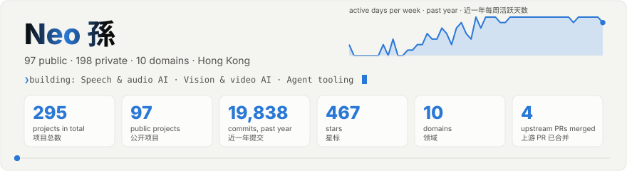
</picture>

<picture>
  <source media="(prefers-color-scheme: dark)" srcset="assets/neofetch-dark.svg">
  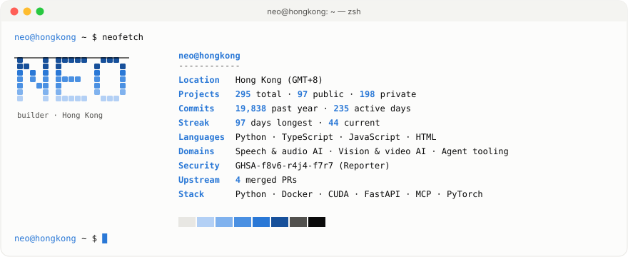
</picture>

I package open-source AI models for speech, translation, OCR and talking-head video into all-in-one Docker images with a Web UI, REST API and MCP server, so they're easy to run locally. I also build agent tooling: MCP servers, AI agent skills and a Bash loop that drives a coding agent through PRD user stories. I've built ZK identity protocols on HashKey Chain and send fixes and security reports upstream.

<picture>
  <source media="(prefers-color-scheme: dark)" srcset="assets/galaxy-dark.svg">
  
</picture>

<picture>
  <source media="(prefers-color-scheme: dark)" srcset="assets/divider-dark.svg">
  
</picture>

## ✨ Highlights

- 🛡️ Credited **Reporter** of security advisory [GHSA-f8v6-r4j4-f7r7](https://github.com/lexmount/moli/security/advisories/GHSA-f8v6-r4j4-f7r7) (high) in [lexmount/moli](https://github.com/lexmount/moli) — moli serve: web pages could take over the CDP endpoint (no Origin / Host validation) and read local files
- 🔧 4 merged pull requests to 2 other open-source projects:
  - [lexmount/moli#2293](https://github.com/lexmount/moli/pull/2293) fix(renderer): never reuse backendNodeIds across Documents
  - [lexmount/moli#2292](https://github.com/lexmount/moli/pull/2292) fix(serve): honor --document-start-script in protocol-server pages
  - [lexmount/moli#2295](https://github.com/lexmount/moli/pull/2295) fix(system-info): accept the frontend's browser session (SystemInfo always rejected over real connections)
  - [wiltodelta/remove-ai-watermarks#11](https://github.com/wiltodelta/remove-ai-watermarks/pull/11) fix(ctrlregen): correct module import paths

## 🚀 Start here

**[cosyvoice-docker](https://github.com/neosun100/cosyvoice-docker)** — ★89 · Python · Speech & audio AI

All-in-one Docker image serving the Fun-CosyVoice3-0.5B TTS model with a Web UI, OpenAI-compatible REST API and voice cloning.

  - OpenAI-compatible /v1/audio/speech endpoint with real PCM streaming at ~1.2s TTFB
  - Custom voice management with Fun-ASR-Nano auto-transcription; embedding cache 53% faster after first use
  - Supports Chinese, English, Japanese, Korean plus 18 dialects; deploy with one docker run command

  `Python` `Docker` `CosyVoice` `Fun-ASR-Nano` `NVIDIA Container Toolkit`

**[translategemma](https://github.com/neosun100/translategemma)** — ★40 · Python · LLM apps

A local AI translation service built on Google's TranslateGemma, offering a Web UI, REST API and MCP integration for 55 languages.

  - All-in-one 82GB Docker image with all 6 models (4B/12B/27B, Q4/Q8) embedded
  - Smart chunking for long text and streaming translation output via REST API
  - MCP integration that works with Claude Desktop and other AI assistants

  `Python` `TranslateGemma` `Docker` `CUDA` `GGUF` `MCP`

**[supertonic-tts-enhanced](https://github.com/neosun100/supertonic-tts-enhanced)** — ★23 · Python · Speech & audio AI

An enhanced packaging of the Supertonic on-device TTS system that bundles it in a Docker image with a FastAPI server and a Streamlit web UI.

  - One-command all-in-one Docker image with GPU (CUDA 12.6.3) or CPU-only mode
  - FastAPI /synthesize endpoint on port 8088 with API docs and a health check
  - Streamlit UI on port 8501 with 4 voice styles, speed/quality settings, downloads and history

  `Python` `ONNX Runtime` `FastAPI` `Streamlit` `Docker` `CUDA`

**[kokoro-tts](https://github.com/neosun100/kokoro-tts)** — ★19 · Python · Speech & audio AI

All-in-one Docker image for Kokoro-82M text-to-speech with a web UI, REST API, WebSocket, streaming, batch and MCP.

  - Supports 8 languages and offers 54+ male and female voices
  - CUDA GPU acceleration with idle-timeout memory release, plus a CPU fallback
  - MCP server lets AI agents such as Claude use the TTS service

  `Python` `Docker` `CUDA` `Kokoro-82M` `WebSocket` `MCP`

**[MuMuAINovel](https://github.com/neosun100/MuMuAINovel)** — ★18 · Python · LLM apps

An AI-powered novel writing assistant that generates outlines, characters, worldbuilding and chapters using OpenAI, Gemini or Claude models.

  - Lets you switch between OpenAI, Gemini, Claude and custom API endpoints
  - Tracks foreshadowing, checks consistency, scores chapter quality (S/A/B/C/D) and detects duplicate content
  - Deploys with Docker Compose on PostgreSQL; README lists 200+ API endpoints

  `Python` `FastAPI` `React` `PostgreSQL` `Docker`

<picture>
  <source media="(prefers-color-scheme: dark)" srcset="assets/divider-dark.svg">
  
</picture>

## 📊 By the numbers

<picture>
  <source media="(prefers-color-scheme: dark)" srcset="assets/timeline-dark.svg">
  
</picture>
<picture>
  <source media="(prefers-color-scheme: dark)" srcset="assets/commits_month-dark.svg">
  
</picture>
<picture>
  <source media="(prefers-color-scheme: dark)" srcset="assets/categories-dark.svg">
  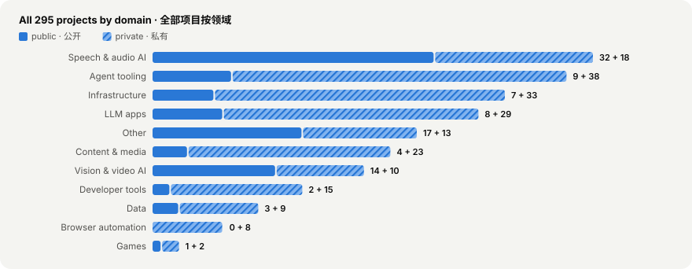
</picture>
<picture>
  <source media="(prefers-color-scheme: dark)" srcset="assets/languages-dark.svg">
  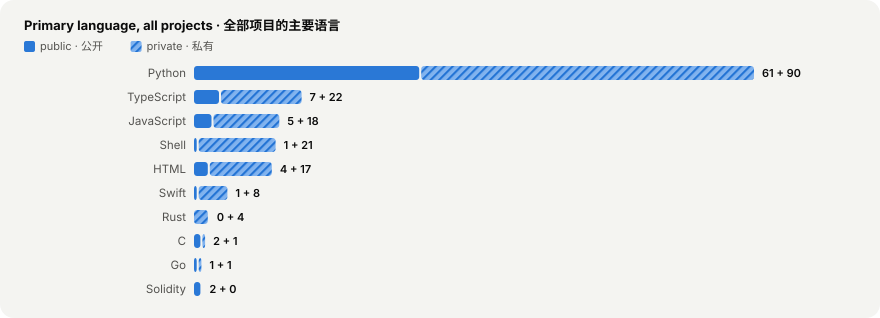
</picture>
<picture>
  <source media="(prefers-color-scheme: dark)" srcset="assets/stars-dark.svg">
  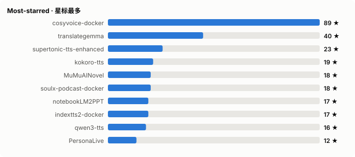
</picture>

<picture>
  <source media="(prefers-color-scheme: dark)" srcset="assets/divider-dark.svg">
  
</picture>

## 🔒 Beyond the public repos

- **19,838 commits** authored in the past year, on **235 different days**, across **225 repositories** (merge commits excluded; counted from local git history).

<picture>
  <source media="(prefers-color-scheme: dark)" srcset="assets/skyline-dark.svg">
  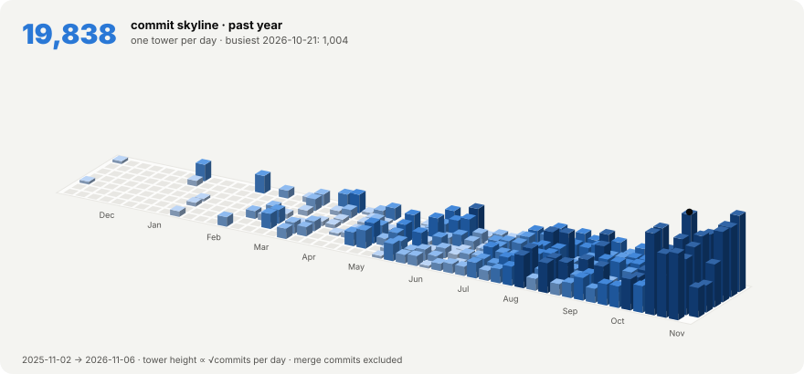
</picture>

<picture>
  <source media="(prefers-color-scheme: dark)" srcset="assets/activity-dark.svg">
  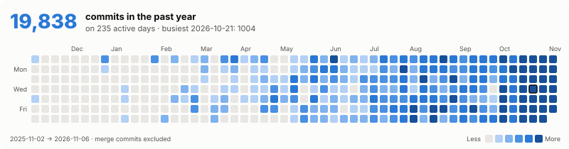
</picture>

<picture>
  <source media="(prefers-color-scheme: dark)" srcset="assets/clock-dark.svg">
  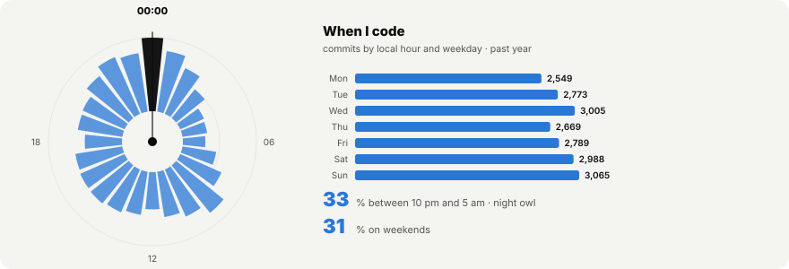
</picture>

- **198 private or unlisted projects** — 8 are introduced below, the rest stay unnamed. By domain: Agent tooling (38), Infrastructure (33), LLM apps (29), Content & media (23), Speech & audio AI (18). Languages: Python (90), TypeScript (22), Shell (21), JavaScript (18), HTML (17).

### 🔒 Private spotlight

_Selected private projects — the code is not public; described here with the owner's permission._

<table>
<tr>
<td width="50%" valign="top"><b>🔒 llm-odyssey</b> Content & media A Chinese LLM explainer video series whose code is written by Claude and rendered frame by frame by a custom engine, with frame = f(t).<ul><li>Custom engine (Bun + three.js + Canvas2D, WebCodecs H.264) renders the same frame bit-identically</li><li>On-screen numbers come from per-episode data scripts that can be recomputed with --check</li><li>Pure policy.decide() caps revisions at 3 rounds; LLM steps are one-shot Agent SDK query() calls</li></ul><code>TypeScript</code> <code>Bun</code> <code>three.js</code> <code>Canvas2D</code> <code>WebCodecs</code> <code>Python</code></td>
<td width="50%" valign="top"><b>🔒 mc-agent</b> Agent tooling An AI society experiment where autonomous LLM residents live in a Minecraft Forge world, building, farming and talking without commands.<ul><li>77 hand-written character cards, 36 residents online across 9 shard processes on a 75-mod Forge server</li><li>Tiered ReflexRouter: L0 emergency reflexes run in under 50ms with no LLM calls</li><li>959 passing tests; safety whitelist stops residents from attacking real players</li></ul><code>JavaScript</code> <code>Node.js</code> <code>mineflayer</code> <code>Python</code> <code>Minecraft Forge</code> <code>uv</code></td>
</tr>
<tr>
<td width="50%" valign="top"><b>🔒 mac-h3c</b> Vision & video AI A C/Metal port of MiniMax-H3 for Apple Silicon that makes video and audio from prompts, with frame and reference conditioning.<ul><li>Prompt-to-video/audio, first/last-frame and ordered Ref2VA image/video/audio references work end to end</li><li>Interactive session keeps prompt conditioning, DiT and decoder in memory to rerun with new seeds</li><li>Speed options: --reuse extrapolates skipped denoising steps, --layers runs fewer transformer blocks</li></ul><code>C</code> <code>Metal</code> <code>FFmpeg</code> <code>Hugging Face</code></td>
<td width="50%" valign="top"><b>🔒 TermHub</b> Agent tooling TermHub is an agent-mode terminal hub where Codex watches Claude Code sessions in the terminal and keeps pushing them toward a goal you set.<ul><li>Codex reads each terminal screen and decides whether to nudge the session, answer for you, or call for a human</li><li>Runs as a macOS Electron desktop app or a pure-Node web server, both on one shared core</li><li>Responsive web UI with touch shortcut keys for answering Claude Code prompts on a phone</li></ul><code>TypeScript</code> <code>Electron</code> <code>Node.js</code> <code>tmux</code> <code>WebSocket</code> <code>pnpm</code></td>
</tr>
<tr>
<td width="50%" valign="top"><b>🔒 touchstone</b> Agent tooling A Claude Code skill set that teaches how to verify code, not write it, routing to existing skills and filling gaps like mutation checks.<ul><li>README badges list 432 tests, 319 registered mutations and 54 verified routes</li><li>Survey of 243 installed skills found 4 that do contract work, and none of the 4 has a forcing function</li><li>Scope was set by a falsification study in which 4 agents read the body text of 32 skills</li></ul><code>Python</code> <code>Claude Code</code></td>
<td width="50%" valign="top"><b>🔒 gba-metro-map</b> Data A code-drawn Greater Bay Area rail map joining MTR, nine-city metros, intercity, HSR and border crossings for route planning.<ul><li>450 HK–Shenzhen stations placed per official maps; zero stations at sea in both map versions</li><li>Cross-border route planning with transfers, crossings and time estimates, plus reachability areas</li><li>Deterministic, rerunnable pipeline from OSM and Natural Earth; no map tiles</li></ul><code>Python</code> <code>uv</code> <code>OpenStreetMap</code> <code>SVG</code> <code>Vitest</code> <code>Capacitor</code></td>
</tr>
<tr>
<td width="50%" valign="top"><b>🔒 moli-control</b> Browser automation A browser CLI for AI agents that drives Moli headless and managed Chrome with one command set, verifying every action.<ul><li>Each command prints one line of JSON, and errors include a machine-readable code and an actionable hint</li><li>Reports unsupported actions explicitly instead of faking success; 304 tests and 202 mutations gate each release</li><li>Has equivalents for 51 of 52 chrome-control subcommands and guards against a webpage taking over the Moli instance</li></ul><code>Python</code> <code>Rust</code> <code>CDP</code> <code>Chrome</code> <code>Moli</code></td>
<td width="50%" valign="top"><b>🔒 chrome-control</b> Browser automation A Python CLI that controls Chrome directly via CDP, including extensions, settings, bookmarks and incognito windows.<ul><li>Claims all 669 CDP commands are reachable; README cites 1867 tests</li><li>Uses chrome:// pages via Runtime.evaluate to list extensions and edit 191 settings</li><li>Only one dependency (websocket-client); targets Chrome 151+</li></ul><code>Python</code> <code>Chrome DevTools Protocol</code> <code>JSON-RPC</code> <code>websocket-client</code></td>
</tr>
</table>

<picture>
  <source media="(prefers-color-scheme: dark)" srcset="assets/divider-dark.svg">
  
</picture>

## 🧰 Stack

<picture>
  <source media="(prefers-color-scheme: dark)" srcset="assets/orbit-dark.svg">
  
</picture>

Full list

`Python` `Docker` `CUDA` `FastAPI` `MCP` `PyTorch` `Gradio` `WebSocket` `TypeScript` `Solidity` `JavaScript` `HashKey Chain` `vLLM` `Swagger` `Flask` `NVIDIA Container Toolkit` `ONNX Runtime` `Docker Compose` `Node.js` `Whisper` `Transformers` `Hardhat` `GGUF` `React` `HuggingFace` `Nginx` `ffmpeg` `HTML`

<picture>
  <source media="(prefers-color-scheme: dark)" srcset="assets/divider-dark.svg">
  
</picture>

## 📦 All public projects (97)

_Every public project, each with a one-line summary._

### Agent tooling (9)

- [**expert-knowledge-extraction**](https://github.com/neosun100/expert-knowledge-extraction) `★4` An AI agent skill that researches a new domain, designs strategic expert interview questions, and turns expert knowledge into method docs.
- [**kirby**](https://github.com/neosun100/kirby) `★3` · Shell Kirby is a Bash loop that runs an AI coding agent on PRD user stories, using a fresh AI instance each iteration until every story is done.
- [**open-vibe-island**](https://github.com/neosun100/open-vibe-island) `★1` · Swift Fork of Open Island, a native macOS notch app showing AI coding agent sessions, permission approvals and terminal jump-back.
- [**zfile-mcp-server**](https://github.com/neosun100/zfile-mcp-server) `★1` · Python An MCP server for ZFile that lets AI assistants list files, upload files, and generate shareable direct or short download links.

5 more

- [**deep-research-ppt-skill**](https://github.com/neosun100/deep-research-ppt-skill) `★1` An AI assistant skill that researches any topic and outputs structured Markdown reports plus a PPT with detailed speaker notes.
- [**hk-horizon-2026-ai-Sentinel-Treasury**](https://github.com/neosun100/hk-horizon-2026-ai-Sentinel-Treasury) · TypeScript AI treasury copilot for HashKey Chain that recommends liquidity, yield and payout splits and executes them on-chain after approval.
- [**hk-horizon-2026-defi-Eternal-Life**](https://github.com/neosun100/hk-horizon-2026-defi-Eternal-Life) · Solidity K-Life is AI agent life insurance on HashKey Chain that watches heartbeats, backs up memory to IPFS and resurrects agents that die.
- [**hk-horizon-2026-ai-OmniAgent**](https://github.com/neosun100/hk-horizon-2026-ai-OmniAgent) · TypeScript Non-custodial yield router where an AI allocator runs sub-agents that pay each other via X402 and verify risk with ZK proofs.
- [**hk-horizon-2026-ai-Pacifica-Pilot**](https://github.com/neosun100/hk-horizon-2026-ai-Pacifica-Pilot) · JavaScript An AI agent that trades Pacifica perpetuals using Gemini and Elfa sentiment, logging each decision on HashKey Chain.

### LLM apps (8)

- [**translategemma**](https://github.com/neosun100/translategemma) `★40` · Python A local AI translation service built on Google's TranslateGemma, offering a Web UI, REST API and MCP integration for 55 languages.
- [**MuMuAINovel**](https://github.com/neosun100/MuMuAINovel) `★18` · Python An AI-powered novel writing assistant that generates outlines, characters, worldbuilding and chapters using OpenAI, Gemini or Claude models.
- [**langextract-web**](https://github.com/neosun100/langextract-web) `★9` · Python A web UI, REST API and MCP server wrapper for Google's LangExtract that uses LLMs to pull structured information out of text.
- [**hy-mt**](https://github.com/neosun100/hy-mt) `★5` · Python All-in-one Docker deployment of Tencent HunyuanMT 1.5 with a Web UI, REST API and MCP server for translation in 38 languages.

4 more

- [**translategemma-cli**](https://github.com/neosun100/translategemma-cli) `★3` · Python A local translation service on Google's TranslateGemma, usable via Web UI, REST API or MCP, covering 55 languages.
- [**fabric-docker**](https://github.com/neosun100/fabric-docker) `★2` · Go An all-in-one Docker deployment of the Fabric AI augmentation framework that runs a Web UI, a REST API, and an MCP server in one container.
- [**PaperRadar**](https://github.com/neosun100/PaperRadar) `★1` · Python A self-hosted AI research platform that finds new arXiv papers, then translates, analyzes and links them and sends alerts.
- [**EasyPaper**](https://github.com/neosun100/EasyPaper) `★1` · Python Self-hosted web app that translates or simplifies English academic PDFs, highlights key sentences, and builds a knowledge base.

### Speech & audio AI (32)

- [**cosyvoice-docker**](https://github.com/neosun100/cosyvoice-docker) `★89` · Python All-in-one Docker image serving the Fun-CosyVoice3-0.5B TTS model with a Web UI, OpenAI-compatible REST API and voice cloning.
- [**supertonic-tts-enhanced**](https://github.com/neosun100/supertonic-tts-enhanced) `★23` · Python An enhanced packaging of the Supertonic on-device TTS system that bundles it in a Docker image with a FastAPI server and a Streamlit web UI.
- [**kokoro-tts**](https://github.com/neosun100/kokoro-tts) `★19` · Python All-in-one Docker image for Kokoro-82M text-to-speech with a web UI, REST API, WebSocket, streaming, batch and MCP.
- [**soulx-podcast-docker**](https://github.com/neosun100/soulx-podcast-docker) `★18` · Python Docker deployment of SoulX-Podcast-1.7B for multi-speaker podcast speech, served via web UI, REST API and MCP server.

28 more

- [**indextts2-docker**](https://github.com/neosun100/indextts2-docker) `★17` · Python Docker images for IndexTTS2 that run zero-shot text-to-speech with emotion control, available through a REST API and a Gradio WebUI.
- [**qwen3-tts**](https://github.com/neosun100/qwen3-tts) `★16` · Python All-in-one Docker deployment of Qwen3-TTS with a Web UI and REST API for custom-voice, voice-design and voice-clone speech.
- [**Qwen3-ASR**](https://github.com/neosun100/Qwen3-ASR) `★11` · Python All-in-one Docker deployment of Qwen3-ASR for 52-language speech recognition with a web UI, REST API and MCP server.
- [**personaplex**](https://github.com/neosun100/personaplex) `★11` · Python All-in-one Docker setup for PersonaPlex, a speech-to-speech model for real-time full-duplex voice chat with role and voice control.
- [**soniox-asr-web**](https://github.com/neosun100/soniox-asr-web) `★7` · JavaScript A Soniox API web app that transcribes audio/video files and does real-time speech recognition and translation over WebSocket.
- [**glm-asr**](https://github.com/neosun100/glm-asr) `★7` · Python A speech recognition service built on GLM-ASR-Nano, offering a Web UI, a REST API with SSE streaming, and segmentation for long audio.
- [**fun-asr-docker**](https://github.com/neosun100/fun-asr-docker) `★7` · Python An all-in-one Docker image that serves Alibaba's Fun-ASR-Nano-2512 speech recognition model through a Web UI, a REST API, and WebSocket.
- [**faster-whisper-web**](https://github.com/neosun100/faster-whisper-web) `★6` · Python A GPU-accelerated speech transcription service built on faster-whisper, with a web UI, streaming output and an OpenAI-compatible API.
- [**mlx-audio**](https://github.com/neosun100/mlx-audio) `★5` · Python A text-to-speech and speech-to-text library and web service built on Apple's MLX framework that streams generated audio on Apple Silicon.
- [**Step-Audio-R1.1**](https://github.com/neosun100/Step-Audio-R1.1) `★4` · Python All-in-one Docker deployment of the Step-Audio-R1.1 audio language model with vLLM, a Web UI and an OpenAI-compatible API.
- [**Fun-Audio-Chat**](https://github.com/neosun100/Fun-Audio-Chat) `★4` · Python All-in-one Docker image for the Fun-Audio-Chat audio language model, with a bilingual web UI, REST API and MCP support.
- [**remove-noise-service**](https://github.com/neosun100/remove-noise-service) `★4` · Python A Dockerized, GPU-accelerated service that removes noise from audio files using the DeepFilterNet model, with a Swagger-documented HTTP API.
- [**whisperlivekit-enhanced**](https://github.com/neosun100/whisperlivekit-enhanced) `★4` · Python Enhanced WhisperLiveKit: a self-hosted, low-latency speech-to-text server with lazy model loading and automatic GPU memory release.
- [**higgs-audio-web**](https://github.com/neosun100/higgs-audio-web) `★3` · Python An all-in-one Docker deployment for Higgs Audio v2 that provides a Web UI, REST API and MCP server for expressive TTS and voice cloning.
- [**chatterbox-tts-docker**](https://github.com/neosun100/chatterbox-tts-docker) `★3` · Python All-in-one Docker image for Resemble AI's Chatterbox TTS with a Web UI, REST API, WebSocket and GPU memory management.
- [**kyutai-tts-docker**](https://github.com/neosun100/kyutai-tts-docker) `★3` · Python A Docker deployment of Kyutai TTS that serves text-to-speech through a web UI, a REST API and MCP tools, and manages the GPU for you.
- [**kyutai-tts-gpu-resident**](https://github.com/neosun100/kyutai-tts-gpu-resident) `★2` · Python A Dockerized Kyutai TTS service that keeps the model in GPU memory, with 584 voices, voice cloning and streaming via web UI and REST API.
- [**VibeVoice**](https://github.com/neosun100/VibeVoice) `★2` · Python Packaging of Microsoft's VibeVoice that serves real-time streaming text-to-speech over WebSocket from a Docker image.
- [**ringtone-forge**](https://github.com/neosun100/ringtone-forge) `★1` · Python A Python CLI and agent skill that turns a song into a 30-second ringtone by finding its chorus and applying a genre-adaptive envelope.
- [**edgetts-ws**](https://github.com/neosun100/edgetts-ws) `★1` · Python A lightweight aiohttp HTTP API that wraps Microsoft Edge TTS and returns MP3 audio plus per-word timestamps for word-by-word highlighting.
- [**fish-speech**](https://github.com/neosun100/fish-speech) `★1` · Python A multilingual text-to-speech system with reusable speaker voice profiles, auto-transcription and emotion control via REST API and WebUI.
- [**IMS-Toucan**](https://github.com/neosun100/IMS-Toucan) `★1` · Python A Docker-packaged build of IMS-Toucan, the University of Stuttgart's multilingual text-to-speech system, with a Web UI and REST API.
- [**orpheus-tts-docker**](https://github.com/neosun100/orpheus-tts-docker) `★1` · Python Docker deployment for Orpheus TTS that serves text-to-speech through a Web UI, a REST API and MCP, and manages GPU loading for you.
- [**Step-Audio2**](https://github.com/neosun100/Step-Audio2) `★1` · Python Docker-ready deployment of the Step-Audio 2 multimodal LLM for audio understanding and speech chat, with smart GPU memory management.
- [**llasa-tts-8b-webui**](https://github.com/neosun100/llasa-tts-8b-webui) `★1` · Python A text-to-speech system built on Llasa-8B that supports voice cloning and is served through a Gradio web UI, a Flask REST API and MCP.
- [**pyvideotrans**](https://github.com/neosun100/pyvideotrans) `★1` An AI-powered tool that translates and dubs videos.
- [**Step-Audio-EditX-GPU-Managed**](https://github.com/neosun100/Step-Audio-EditX-GPU-Managed) `★1` · Python Step-Audio-EditX audio editing model with added GPU memory management that loads models on demand and offloads them when idle.
- [**Step-Audio-EditX-Optimized**](https://github.com/neosun100/Step-Audio-EditX-Optimized) · Python Optimized deployment of Step-Audio-EditX, a 3B LLM audio editing and zero-shot TTS model, with UI and API sharing one model instance.

### Vision & video AI (14)

- [**PersonaLive**](https://github.com/neosun100/PersonaLive) `★12` · Python A live-streaming portrait animation tool that animates a reference portrait from a webcam in real time or from a driving video offline.
- [**sharp**](https://github.com/neosun100/sharp) `★8` · Python All-in-one Docker for Apple's SHARP model that turns one photo into a 3D Gaussian Splat scene, via Web UI, REST API or MCP.
- [**infinitetalk-deployment**](https://github.com/neosun100/infinitetalk-deployment) `★8` · Python Docker and Gradio deployment for MeiGen-AI's InfiniteTalk and MultiTalk audio-driven video models, with auto model download.
- [**StableAvatar**](https://github.com/neosun100/StableAvatar) `★5` · Python Docker deployment of StableAvatar that turns one image plus audio into a talking-head video of any length.

10 more

- [**HunyuanOCR-WebUI**](https://github.com/neosun100/HunyuanOCR-WebUI) `★4` · Python A Gradio web UI for Tencent's 1B-parameter HunyuanOCR model for text spotting, document parsing, info extraction and image translation.
- [**monkeyocr-multimodel**](https://github.com/neosun100/monkeyocr-multimodel) `★3` · Python A MonkeyOCR fork that adds Qwen2.5-VL-3B and Qwen3-VL-8B support to document parsing for handwritten ancient Chinese recognition.
- [**seedvr2-docker-allinone**](https://github.com/neosun100/seedvr2-docker-allinone) `★3` · HTML A Docker all-in-one build of ByteDance SeedVR2 that upscales videos and images through a bilingual web UI with a task queue.
- [**depth-pro-docker**](https://github.com/neosun100/depth-pro-docker) `★2` · Python Docker deployment of Apple's Depth Pro for single-image metric depth estimation, with a Web UI, REST API and MCP server.
- [**ditto-talkinghead**](https://github.com/neosun100/ditto-talkinghead) `★2` · Python A motion-space diffusion system that turns a single portrait image and an audio clip into a realistic, controllable talking head video.
- [**Z-Image-Studio**](https://github.com/neosun100/Z-Image-Studio) `★1` · Python An all-in-one Z-Image-Turbo toolkit for model downloads, multi-LoRA inference, LoRA training, and web UI management.
- [**Step1X-Edit-Docker**](https://github.com/neosun100/Step1X-Edit-Docker) `★1` · Python A Docker deployment of the Step1X-Edit image-editing model that offers a UI, an API and an MCP server, and manages GPU memory automatically.
- [**ovis-image-docker**](https://github.com/neosun100/ovis-image-docker) `★1` · Python Docker deployment for the Ovis-Image 7B text-to-image model that serves a Web UI, REST API and MCP server from one container.
- [**yolo11x-stream-detection**](https://github.com/neosun100/yolo11x-stream-detection) `★1` · Python A Dockerized system that runs Ultralytics YOLO11x detection on live RTMP video streams and serves annotated output over HLS.
- [**dots-ocr**](https://github.com/neosun100/dots-ocr) `★1` · Python A ~1.7B-parameter multilingual vision-language model that parses document layouts and recognizes their content.

### Developer tools (2)

- [**electrify-web**](https://github.com/neosun100/electrify-web) `★3` · TypeScript A CLI tool that turns any website into a desktop app with one command, built as a modern revival of the abandoned Nativefier project.
- [**cursor-session-manager**](https://github.com/neosun100/cursor-session-manager) `★1` · HTML A Cursor AI IDE tool that saves, restores, searches and auto-saves Cursor Agent conversation history via a web UI or CLI.

### Infrastructure (7)

- [**lean-allinone**](https://github.com/neosun100/lean-allinone) `★6` · Python All-in-one Docker image for the QuantConnect Lean trading engine with GPU support, a Web UI, a REST API and an MCP server.
- [**kimi-linear-vllm-docker-serve**](https://github.com/neosun100/kimi-linear-vllm-docker-serve) `★2` · Python Docker image that serves Kimi-Linear-48B-A3B (AWQ-4bit) via vLLM with an OpenAI-compatible API and 128K–1M context.
- [**f-stack**](https://github.com/neosun100/f-stack) `★1` · C A copy of Tencent Cloud's F-Stack, a DPDK framework running the FreeBSD 13.0 network stack in user space, with added reports and docs.
- [**gpu-container-monitor**](https://github.com/neosun100/gpu-container-monitor) `★1` · HTML A real-time web dashboard for monitoring NVIDIA GPUs and managing GPU-enabled Docker containers.

3 more

- [**hk-horizon-2026-zkid-Veritier**](https://github.com/neosun100/hk-horizon-2026-zkid-Veritier) · TypeScript A privacy-preserving tiered identity and access protocol for humans and AI agents on HashKey Chain, using Groth16 ZK proofs.
- [**hk-horizon-2026-zkid-Aria-Protocol**](https://github.com/neosun100/hk-horizon-2026-zkid-Aria-Protocol) · JavaScript Compliance middleware on HashKey Chain combining ZK-KYC, AI risk scoring, ERC-4626 vaults and HSP settlement for institutional DeFi.
- [**quickwit-benchmark**](https://github.com/neosun100/quickwit-benchmark) · Python A Locust-based load testing project that measures query performance of the Quickwit logging system under concurrent users.

### Data (3)

- [**deepwiki-scraper**](https://github.com/neosun100/deepwiki-scraper) `★4` · JavaScript A tool that scrapes DeepWiki project documentation and merges it into a single Markdown file, via a command line or a web interface.
- [**tradingview-api-python**](https://github.com/neosun100/tradingview-api-python) `★1` · JavaScript A Python FastAPI service serving TradingView real-time market data, technical analysis and indicators via REST.
- [**hk-horizon-2026-defi-Critmin-Oracle**](https://github.com/neosun100/hk-horizon-2026-defi-Critmin-Oracle) · Python An on-chain oracle on HashKey Chain Testnet that publishes AI-computed risk scores for lithium, nickel and cobalt for DeFi use.

### Games (1)

- [**CoolSnakeGame**](https://github.com/neosun100/CoolSnakeGame) `★1` · Python A cyberpunk-styled neon snake game in Python and Pygame where you can play solo, watch an AI play, or compete against it.

### Content & media (4)

- [**notebookLM2PPT**](https://github.com/neosun100/notebookLM2PPT) `★17` · Python A Python tool that converts PDF slides like NotebookLM exports into vector-graphics PowerPoint files via CLI, web UI, API or MCP.
- [**google-flow-downloader**](https://github.com/neosun100/google-flow-downloader) `★2` · Python A Python CLI that batch downloads AI-generated images from Google Flow via a browser-exported JSON file or direct API access.
- [**calendar-format**](https://github.com/neosun100/calendar-format) `★1` · Python A Python CLI that merges Taoist, Buddhist and Hong Kong holiday data into a landscape A4 calendar PDF, one page per month.
- [**pdf2ppt**](https://github.com/neosun100/pdf2ppt) `★1` · Python A Python tool that converts PDF slides into PowerPoint presentations while keeping vector graphics at the highest resolution.

### Other (17)

- [**polycopy**](https://github.com/neosun100/polycopy) `★6` · TypeScript A TypeScript bot that copies trades from chosen Polymarket traders, with risk controls, a web dashboard, REST API and MCP server.
- [**FanPilot**](https://github.com/neosun100/FanPilot) `★2` · C A macOS menu bar app and daemon for Apple Silicon that holds fans at a set percentage and runs them at full speed when the Mac overheats.
- [**looptrade**](https://github.com/neosun100/looptrade) `★1` New loop project
- [**python3**](https://github.com/neosun100/python3) `★1` all_python

13 more

- [**insight**](https://github.com/neosun100/insight) `★1`
- [**hk-horizon-2026-zkid-ZKGate**](https://github.com/neosun100/hk-horizon-2026-zkid-ZKGate) · TypeScript A HashKey Chain protocol that lets users prove KYC, age or accredited status to DeFi apps via ZK proofs without revealing personal data.
- [**hk-horizon-2026-defi-eldra**](https://github.com/neosun100/hk-horizon-2026-defi-eldra) · TypeScript Eldra is a monorepo for an RWA protocol covering fundraising, fractional ownership, secondary trading and liquidity rewards.
- [**hk-horizon-2026-defi-hash-credit**](https://github.com/neosun100/hk-horizon-2026-defi-hash-credit) · Solidity HashCredit is a HashKey Chain protocol that turns SPV-proven Bitcoin mining payouts into credit lines for borrowing stablecoins.
- [**dots.ocr**](https://github.com/neosun100/dots.ocr)
- [**soulbridge**](https://github.com/neosun100/soulbridge) SoulBridge is an AI application for practicing languages.
- [**crawler_demo2**](https://github.com/neosun100/crawler_demo2) · HTML
- [**crawler_demo**](https://github.com/neosun100/crawler_demo)
- [**MWAA_best_practice**](https://github.com/neosun100/MWAA_best_practice)
- [**emr-jupyterlab**](https://github.com/neosun100/emr-jupyterlab) emr-jupyterlab
- [**guetzli**](https://github.com/neosun100/guetzli) mytest git
- [**HPT**](https://github.com/neosun100/HPT) Real estate block chain
- [**Shamir-Secret-0th-test**](https://github.com/neosun100/Shamir-Secret-0th-test) · Python A Python command-line PoC that splits secrets like Ethereum, Bitcoin or login keys into shares using Shamir's Secret Sharing.

---

_And 198 more private or unlisted projects._

🥚

- 19,841 commits since 2025-04 (merge commits excluded)
- busiest day: 2026-10-21, with 1,004 commits
- longest streak: 97 days in a row
- 33% of commits land between 10 pm and 5 am; favourite hour: 00:00
- if every commit were a step, that walk would be about 15.1 km

<picture>
  <source media="(prefers-color-scheme: dark)" srcset="assets/waves-dark.svg">
  
</picture>

This page is generated from repository data by a private tool. Every repository linked here is re-verified public before publishing; counts and charts are recomputed from the same data, never hand-written.
